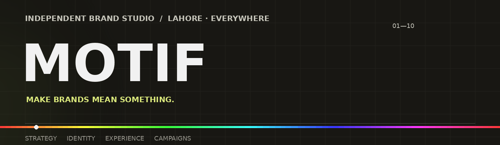
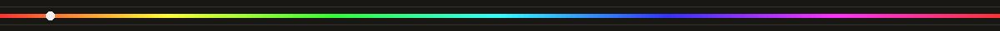

<div align="center">
  

  <br>

**An expressive, responsive portfolio template for independent creative studios.**

Built as a static, hand-editable site with original sample copy, custom-made campaign imagery, and scroll-led interactions.

  <br>


</div>



## At a glance

**Motif** is a fictional brand studio used to demonstrate a long-form creative-agency portfolio. The visual direction takes cues from editorial studio sites: oversized typography, still-image campaigns, off-white and near-black surfaces, a scroll-linked feature reel, and small interactive details.

- **Responsive:** designed for wide desktop, tablet, and touch screens.
- **Motion-led:** intro curtain, crossfading hero stills, reveal transitions, pinned work reel, marquees, and a custom pointer on desktop.
- **Usable:** keyboard-friendly controls, accessible labels, visible focus states, and reduced-motion support.
- **Portable:** static files only; no account, framework, package manager, build command, or external font required.
- **Editable:** project copy and imagery are easy to replace in a small folder tree.

> The case studies and studio details are fictional sample content. Replace the demo identity, contact address, locations, and project stories before publishing it as your own portfolio.


## Preview

### Run it on your computer

1. Download or clone the repository.
2. Open the project folder in a terminal.
3. Start a tiny local web server:

   ```bash
   python -m http.server 4173
   ```

4. Visit **http://localhost:4173** in your browser.

You can also open `index.html` directly for a quick look. A local server is recommended so relative files behave just like they will on GitHub Pages.


## What’s inside

```text
motif-portfolio/
├── index.html                 # Page structure and content
├── css/
│   └── style.css              # Theme, responsive layouts, and motion
├── js/
│   └── main.js                # Menu, gallery, dialogs, city selector, cookies
├── assets/
│   ├── project-*.jpg          # Ten custom demo campaign images
│   ├── favicon.svg            # Small Motif monogram
│   ├── readme-banner.gif      # Animated rainbow README header
│   └── readme-divider.gif     # Animated section divider
├── .gitignore
├── .nojekyll
└── README.md
```


## Interactions

| Area             | What it does                                                                          |
| ---------------- | ------------------------------------------------------------------------------------- |
| Navigation       | Fixed links on desktop; full-screen menu on smaller screens                           |
| Hero             | Five stills crossfade; the small index controls select a frame                        |
| Featured work    | Five full-bleed projects move with page scroll; arrows and segments jump between them |
| Project index    | Switch between list and grid; select any row to read its case-study panel             |
| Studio notes     | 43-note horizontal card rail with arrow controls and readable story panels            |
| Studio locations | Select a city to update the location detail                                           |
| Cookie notice    | Accept, reject, or save individual analytics/marketing preferences                    |
| Pointer          | Context label follows a fine pointer; hidden on touch devices                         |


## Make it yours

### 1. Change the studio identity

Search and replace **Motif** in `index.html`, the page title and description, and the project copy in `js/main.js`. Update the contact placeholders (`hello@yourdomain.com`) and the city list before launch.

### 2. Replace the project images

The ten demo images live in `assets/`. Keep the same filenames for a quick swap, or change the paths in both `index.html` and `js/main.js`. Landscape images around **3:2** work well; the hero crops to fill the screen, so keep important subjects near the middle.

### 3. Edit the project stories

Project data is near the top of `js/main.js` in the `projects` array. Each entry includes a title, category, image, year, services, short description, and story. The 10 visible index rows are in `index.html`; keep their `data-project-open` numbers aligned with the array order.

### 4. Tune the look

Start with the custom properties at the top of `css/style.css`:

```css
:root {
  --ink: #181713;
  --paper: #f1f1f1;
  --accent: #e995a3;
}
```

The remaining responsive breakpoints and motion are in that same stylesheet.


## Technology notes

The reference is a Webflow-published site, with Webflow’s generated markup, styling, CMS/runtime, and JavaScript interactions. This repository is a **static recreation**, not a Webflow export: it uses semantic HTML, CSS, and plain JavaScript so it can be edited in any text editor and hosted on GitHub Pages without a build step. The interaction patterns are re-created locally instead of relying on Webflow hosting or a paid CMS.

No analytics, tracking pixel, external font, or third-party JavaScript is loaded by this template. The consent panel is a front-end demo; add a real consent-management / analytics integration only if your published site needs one.


## Accessibility & performance

- Respects `prefers-reduced-motion` and provides a stacked alternative to the scroll-pinned gallery.
- Supports keyboard navigation, Escape-to-close dialogs, semantic headings, and labelled buttons.
- Uses local image files and system font stacks to avoid third-party loading dependencies.
- The cookie choices are stored in the browser’s local storage; they do not contact a server.

## License & attribution

No formal open-source license is included yet; choose and add one before inviting others to reuse or redistribute the template. The named brands, writing, and generated sample imagery are fictional demonstration material, not client work or performance claims. Review rights and licensing for every replacement asset before publishing. This is an independent recreation exercise and is **not affiliated with or endorsed by Bulletproof**; do not use Bulletproof’s name, logo, copy, or original site assets as part of your published version.

---

<div align="center">
  <sub>Give a good idea room to become a great one.</sub><br>
  <sub>© 2026 · Motif Studio Template</sub>
</div>
